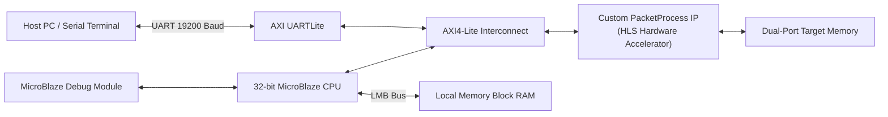

# Xilinx Vivado MicroBlaze SoC: HW/SW Co-Design & HLS Packet Accelerator

[](https://www.xilinx.com/products/design-tools/vivado.html)
[](https://www.xilinx.com/products/design-tools/vivado/integration/esl-design.html)
[](#microblaze-subsystem-architecture)
[](https://www.xilinx.com/)
[](LICENSE)

An end-to-end FPGA System-on-Chip (SoC) co-design project integrating a **32-bit MicroBlaze RISC soft processor** with memory interconnects, AXI peripherals, and a custom **High-Level Synthesis (HLS) hardware accelerator** for serial packet protocol parsing and checksum verification.

---

## Table of Contents
- [Project Overview](#project-overview)
- [System Architecture](#system-architecture)
  - [Phase 1: MicroBlaze Core Subsystem](#phase-1-microblaze-core-subsystem)
  - [Phase 2: Custom HLS Hardware Accelerator](#phase-2-custom-hls-hardware-accelerator)
- [Packet Framing Protocol Specification](#packet-framing-protocol-specification)
- [HLS Synthesis & Resource Utilization](#hls-synthesis--resource-utilization)
- [Firmware & Verification](#firmware--verification)
- [Repository Structure](#repository-structure)
- [How to Build & Run](#how-to-build--run)

---

## Project Overview

Modern embedded FPGA systems balance flexibility and throughput through **Hardware/Software Partitioning**:
- **Software Domain (MicroBlaze RISC Core):** Handles application control flow, UART configuration, memory orchestration, and system diagnostics.
- **Hardware Domain (Custom HLS IP Block):** Accelerates repetitive framing validation, checksum calculation, and cycle-accurate memory address generation at line rate.



---

## System Architecture

### Phase 1: MicroBlaze Core Subsystem
The primary processor subsystem was architected in Vivado IP Integrator (`vivado_bd/design_1_phase1.bd`):
1. **MicroBlaze Core:** 32-bit Harvard architecture RISC processor with barrel shifter and exception handling.
2. **Local Memory Bus (LMB):** Dedicated instruction and data bus interfaces connected to dual-port Block RAM via `lmb_bram_if_cntlr`.
3. **AXI4-Lite Interconnect (`xbar`):** High-speed crossbar linking the CPU master to slave peripherals.
4. **AXI UARTLite:** Serial communications interface configured for 19,200 baud, 8 data bits, and Even parity.
5. **AXI Interrupt Controller (`axi_intc`):** Aggregates peripheral interrupt requests into the MicroBlaze interrupt port.
6. **Clocking Wizard & Processor Reset:** Generates 100 MHz system clock with synchronous reset synchronization.

### Phase 2: Custom HLS Hardware Accelerator
The serial packet parser (`PacketProcess`) was specified in C/C++ and compiled to synthesizable VHDL and Verilog using **Vivado HLS**:
- Parses packet stream byte-by-byte with 1-cycle initiation interval.
- Computes running checksums and verifies integrity before asserting write/read enable strobes.
- Emits response frames directly with zero CPU intervention.
- Packaged as an AXI IP core (`PacketProcess_0_0`) and instantiated in `vivado_bd/design_1_phase2.bd`.

---

## Packet Framing Protocol Specification

| Field | Size | Allowed Values / Format | Description |
| :--- | :--- | :--- | :--- |
| **Header** | 1 Byte | `0x3B` (`';'`) | Start-of-Frame delimiter |
| **Command** | 1 Byte | `0x00` (Write), `0xFF` (Read) | Transaction type opcode |
| **Address** | 2 Bytes | `0x0000` – `0xFFFF` (Big-Endian) | Target 16-bit register/memory address |
| **Data Payload** | 4 Bytes | 32-bit integer | Write payload (omitted on read command) |
| **Checksum** | 2 Bytes | Sum of preceding bytes | 16-bit packet validation checksum |

---

## HLS Synthesis & Resource Utilization

Synthesized using Vivado HLS for the Xilinx Zynq-7000 (`xc7z010-clg225-2`):

| Metric | Target Constraint | Achieved HLS Result | Margin / Slack |
| :--- | :--- | :--- | :--- |
| **Clock Period** | 10.00 ns (100 MHz) | **4.889 ns (204.5 MHz)** | +5.111 ns (Positive slack) |
| **Execution Latency** | ≤ 2 cycles | **1 clock cycle** | Line-rate processing |
| **Block RAM (BRAM_18K)** | 60 available | **0 (0%)** | Fully logic-based |
| **DSP48E Slices** | 80 available | **0 (0%)** | No DSP overhead |
| **Flip-Flops (FF)** | 35,200 available | **374 (1.06%)** | Ultra-compact footprint |
| **Look-Up Tables (LUT)** | 17,600 available | **621 (3.53%)** | Lightweight logic utilization |

---

## Firmware & Verification

### 1. Standalone C Testbench (`firmware/packet_checker.c`)
A self-contained behavioral simulation verifying packet parsing, error rejection, and memory response generation without requiring FPGA hardware or Vivado tools:
```bash
gcc -Wall -O2 firmware/packet_checker.c -o packet_checker_test
./packet_checker_test
```
**Test Results:**
- **Write Transaction:** Successfully unpacked header `0x3B`, address `0x0614`, data payload `0xFF550121`, matched checksum `0x01CB`, and asserted `wrEn`.
- **Read Transaction:** Unpacked read command `0xFF` for address `0x0614`, verified checksum `0x0154`, and triggered read strobe `rdEn`.
- **Response Generator:** Emitted header `0x3B`, opcode `0xFF`, 32-bit word `0x12345678`, and calculated response checksum `0x024E` with `dataOutRdy`.

### 2. MicroBlaze SDK Firmware (`firmware/microblaze_uart_firmware.c`)
Bare-metal C driver executing on the MicroBlaze processor:
- Initializes platform timers and cache controllers (`init_platform()`).
- Performs hardware self-test on the AXI UARTLite peripheral (`UARTLite_Init_SelfTest()`).
- Transmits data buffers over serial at 19,200 baud with Even parity.

---

## Repository Structure

```
09_Vivado_MicroBlaze_SoC/
├── docs/
│   ├── MicroBlaze_Project_Specification.pdf    # Academic project requirements
│   ├── report_MicroBlaze_phase1.pdf            # Phase 1 Subsystem report
│   └── report_MicroBlaze_phase2.pdf            # Phase 2 HLS & IP co-design report
├── firmware/
│   ├── microblaze_uart_firmware.c              # Xilinx SDK bare-metal firmware
│   └── packet_checker.c                        # C behavioral simulation & testbench
├── hdl/
│   ├── PacketProcess.vhd                       # Synthesizable VHDL top-level IP
│   └── PacketProcess.v                         # Synthesizable Verilog top-level IP
├── hls/
│   ├── PacketProcess.cpp                       # SystemC / C++ HLS source
│   ├── PacketProcess.h                         # HLS interface header
│   └── PacketProcess_csynth.rpt                # Vivado HLS synthesis report
├── vivado_bd/
│   ├── design_1_phase1.bd                      # Vivado block design: MicroBlaze Subsystem
│   └── design_1_phase2.bd                      # Vivado block design: Co-designed with IP
├── Makefile                                    # Quick compilation for C testbench
├── .gitignore
└── README.md
```

---

## How to Build & Run

### Testing C Firmware Simulation (Cross-Platform)
```bash
# Using GCC
make test

# Or directly:
gcc -Wall -O2 firmware/packet_checker.c -o packet_test && ./packet_test
```

### Vivado Project Recreation
1. Open Xilinx Vivado (2019.1 or newer).
2. Create a new RTL Project targeting Zynq-7000 or Artix-7.
3. In Tcl Console, import the block design:
   ```tcl
   open_bd_design vivado_bd/design_1_phase2.bd
   generate_target all [get_files design_1_phase2.bd]
   make_wrapper -files [get_files design_1_phase2.bd] -top
   ```
4. Run Synthesis, Implementation, and generate Bitstream.
5. Export Hardware (`.xsa` / `.hdf`) and launch Xilinx SDK / Vitis to run `firmware/microblaze_uart_firmware.c`.
